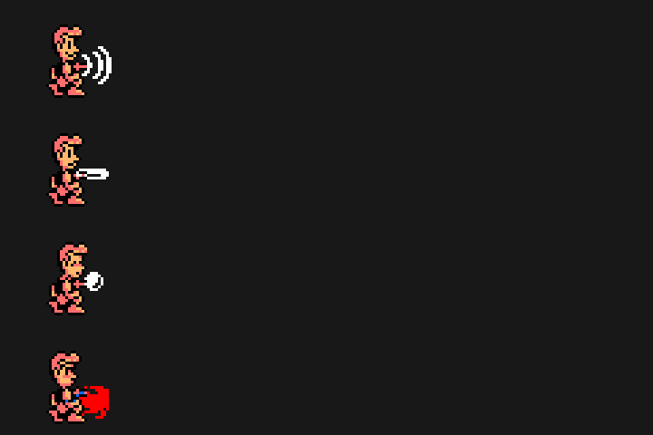
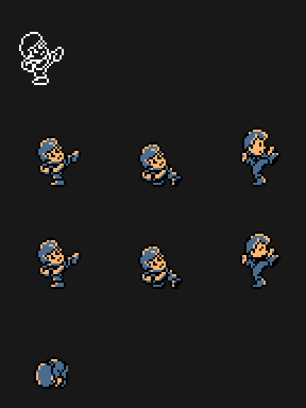
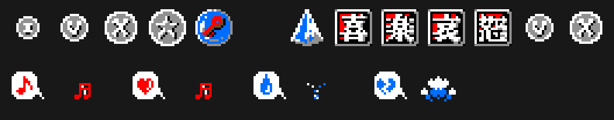

# Findings

Everything on this page is read in the code; none of it has been seen in the
emulator yet.

## Mood changes the game

Each hero has four states: happy, calm, sad and angry (`p06:A644`). A happy
Wit jumps a second time in the air, once per jump (`p01:64F1`); a happy Cles
keeps walking on thin air for 32 frames as long as the direction is held
(`p01:62C7`).

## One shot and one blow per state

Wit's shot is type 4 minus the state: waves, bar, ball or beam
(`p01:6B0D`); Cles's blow is the state plus 6 (`p09:B7C9`). An angry Cles
hits hard and breaks the big crate (`p01:7398`, `p01:7431`). Happy, nobody
pushes blocks; the other three states push them, each at its own speed
(`p01:7BD0`).

## The 喜楽哀怒 items

Each one sets its mood (`p01:75EE`), and each ruin sets the starting one
(`p00:4575`).

## The pause is a shop

In INFORMATION you buy SPD and JMP with coins (`p06:A0EA`). The prices
depend on the character: Wit 70 and 60, Cles 50 and 80 (`p06:BF6C`).

## Other Konami cartridges

The game looks in the other slots for four catalogue numbers (`p06:B751`):

| Cartridge | What it gives |
|---|---|
| RC-749 (The Maze of Galious) | you start with 100 coins (`p00:45F7`) |
| RC-750 (Metal Gear) | half the damage (`p01:72FF`) |
| RC-751 (Nemesis 2) | F5 CONTINUE after GAME OVER (`p00:4427`) |
| RC-752 (F1 Spirit) | the happy powers, always (`p01:64F1`, `p01:62C7`) |

## Two languages in one cartridge

A Japanese MSX gets the texts in Japanese; any other, in English
(`0x002B`, `p05:9849`). The font holds hiragana and 28 kanji (`p14:9289`).

## The passwords are the names of the ruins

On reaching ruins 1-4, a map makes the ruin blink and types out its
password: JUBA RUINS, HARAPPA RUINS, GANDHARA RUINS or MOHENJO DARO
(`p06:A2BB`). On the title screen, CTRL or button B asks for it (KEYWORD,
`p00:4643`), and with it you start at that ruin (`p00:45CB`).
