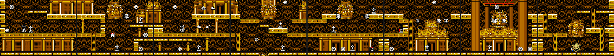
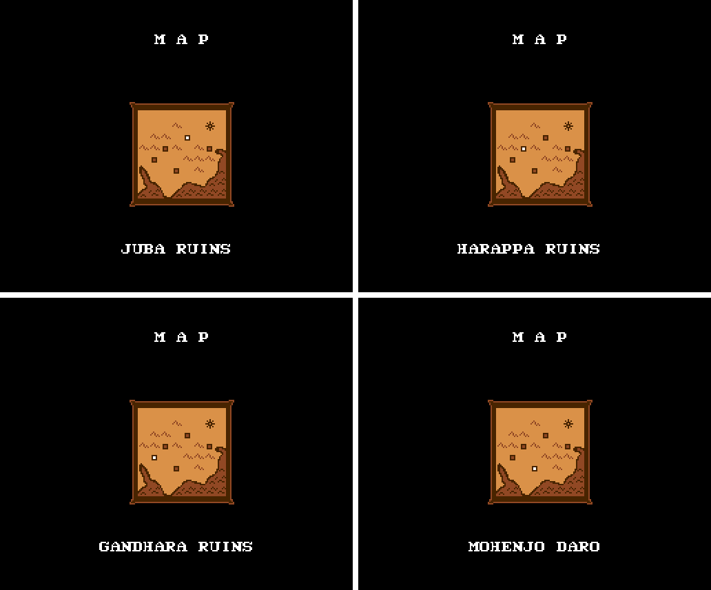
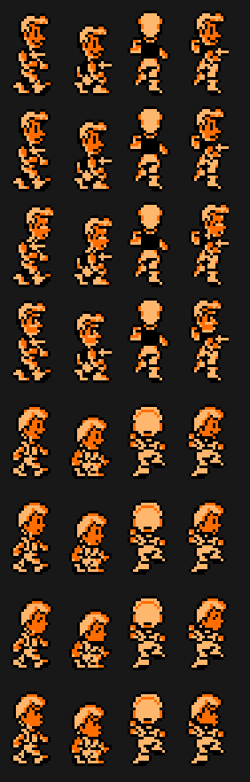
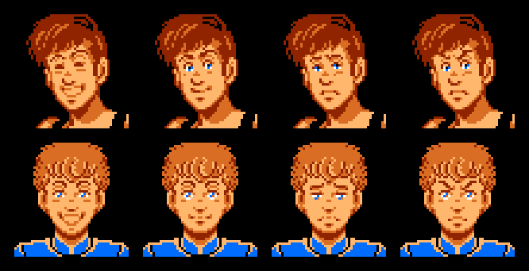
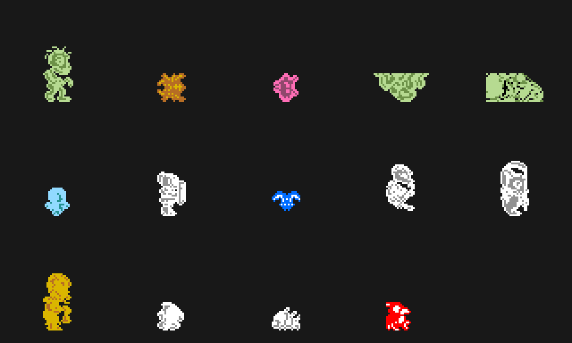
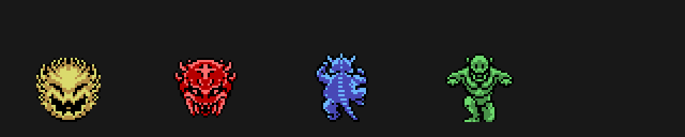
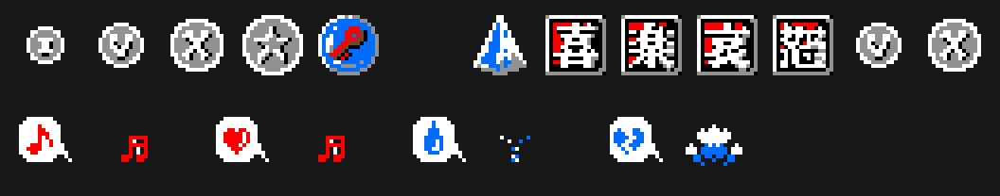
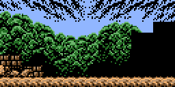

# What the cartridge draws

Under each picture is where it comes from and what is on it.

*The title screen, built from the ROM: the 14 x 15 tile map at <code>p05:9988</code> (<code>p05:96EA</code>). Not yet checked against the VRAM.*

*The first stage of the first ruin, screen by screen (map <code>p10:5FFE</code>), with what each holds on entry: enemies and their nests (<code>p09:B12B</code>), traps (<code>p15:A4F9</code>), items (<code>p12:B8BB</code>) and the boss (<code>p09:BED3</code>).*

*The outside map (<code>p05:93C6</code>) with the ruin marked and its password, for ruins 1-4.*

*Wit and Cles walking, built piece by piece (<code>p00:5BC6</code>) from their frame tables (<code>p14:97AE</code>, <code>p14:9BCE</code>), at the pace of <code>p01:69E6</code>.*

*The INFORMATION faces, one per mood (<code>p06:A644</code>, <code>p06:A64C</code>).*

*The enemies from each screen's list (<code>p09:B12B</code>), with their frames (<code>p15:B744</code>) and colours.*

*The four stage bosses, types 30 to 33.*

*The items you pick up (<code>p03:A81D</code>) and the balloon shown when the mood changes (<code>p15:A426</code>).*

*One of the ending scenes, with the tiles left by the previous one (<code>p04:71D5</code>).*
