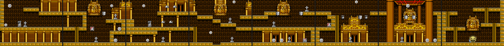
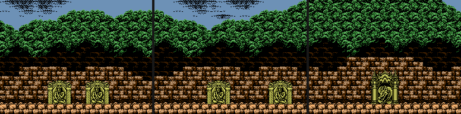
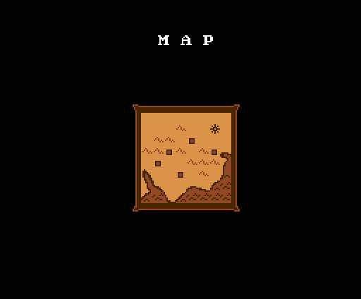
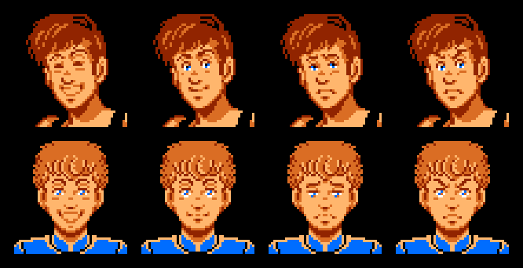
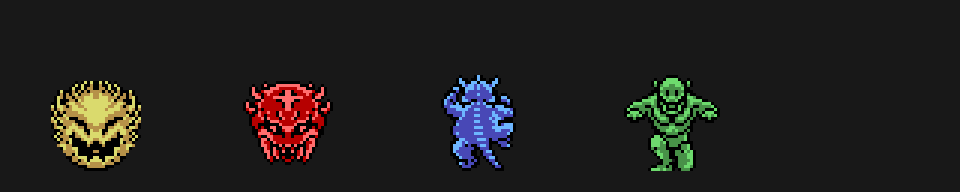
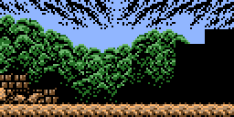

# El juego

*The Treasure of Usas* (Konami, 1987, RC-753) es un juego de plataformas para
MSX2 con dos protagonistas, Wit y Cles. Todo lo que hay en esta página sale de
las tablas del cartucho.

## La historia

El prólogo del título (`p05:9849`) cuenta que el tesoro de Usas se partió en
cuatro con el paso de los siglos, y que los dos salen hacia la Ruta de la Seda
a buscarlo. La primera ruina, según la escena de entrada, es la de Pegu, en
Rangún (Birmania), que descubrió el profesor Atley (`p04:752B`).

## Las ruinas y las fases

Son cinco ruinas (`0xC21D`), cada una con cuatro fases y una sala de la
estatua: 20 fases en total. En el marcador se llaman Pegu, Dunhuang, Alchi,
Hunza y Agra (`p15:BE3D`). Cada pantalla son 8 × 6 metabloques de 4 × 4
fichas (`p15:BEBF`); el mapa de cada fase es un RLE de `p10:5FFE`, y los
metabloques de cada ruina, otro de `p10:6032`. Las pantallas se colocan por
sus vecinas (`p09:B921`).

Cada pantalla lleva lo que el juego pone al entrar: los enemigos que se crean
ya y los nidos de los que salen los demás (`p09:B12B`), las trampas
(`p15:A4F9`), los objetos (`p12:B8BB`) y, en su sala, el jefe (`p09:BED3`).
De cada sprite se pinta el primer cuadro de su animación.

Las veinte fases, a tamaño real:
[1](../imagenes/fase_01_habitada.png), [2](../imagenes/fase_02_habitada.png),
[3](../imagenes/fase_03_habitada.png), [4](../imagenes/fase_04_habitada.png),
[6](../imagenes/fase_06_habitada.png), [7](../imagenes/fase_07_habitada.png),
[8](../imagenes/fase_08_habitada.png), [9](../imagenes/fase_09_habitada.png),
[11](../imagenes/fase_11_habitada.png), [12](../imagenes/fase_12_habitada.png),
[13](../imagenes/fase_13_habitada.png), [14](../imagenes/fase_14_habitada.png),
[16](../imagenes/fase_16_habitada.png), [17](../imagenes/fase_17_habitada.png),
[18](../imagenes/fase_18_habitada.png), [19](../imagenes/fase_19_habitada.png),
[21](../imagenes/fase_21_habitada.png), [22](../imagenes/fase_22_habitada.png),
[23](../imagenes/fase_23_habitada.png), [24](../imagenes/fase_24_habitada.png).
Y solo con las fichas: [1](../imagenes/fase_01.png), [6](../imagenes/fase_06.png),
[11](../imagenes/fase_11.png), [16](../imagenes/fase_16.png),
[21](../imagenes/fase_21.png) (las demás se llaman `fase_NN.png`).

## La antesala

Antes de cada fase hay una puerta que solo deja pasar a uno: «ONLY ONE PERSON
MAY ENTER?» (`p06:BB2F`). Se elige quién entra y el otro se despide con una
frase que depende de su ánimo (`p12:B85E`). Sin las cuatro llaves, la puerta
del final no se abre («YOU HAVE TO GATHER FOUR KEYS»). Y si uno ha caído: «I
CAPTURED YOUR FRIEND».

## Las claves

Al llegar a las ruinas 1-4, un mapa hace parpadear la ruina y escribe a
máquina su clave: JUBA RUINS, HARAPPA RUINS, GANDHARA RUINS o MOHENJO DARO
(`p06:A2BB`). En el título, CTRL o el botón B piden la clave (KEYWORD,
`p00:4643`), y con ella se empieza en esa ruina (`p00:45CB`).

## Wit, Cles y el ánimo

Cada uno tiene cuatro estados (feliz, tranquilo, triste y enfadado) y cada
estado cambia su salto, su disparo o golpe y su forma de empujar: está en
[Hallazgos](HALLAZGOS.md). Las caras de la pantalla INFORMATION cambian con el
estado y mueven la boca cada 8 cuadros mientras hablan (`p06:A774`).

## Monedas e INFORMATION

Las monedas van en BCD (`p00:55B9`) y salen de los objetos de las clases 1 a 4
y 12-13. En la pausa se gastan en SPD y JMP (`p06:A0EA`).

## Enemigos, trampas y jefes

- Los **enemigos** son 63 tipos de actor (`p02:82E9`), puestos pantalla a
  pantalla por `p09:B12B`.
- Las **trampas** (gotas, rocas, estatuas, columnas) son otra lista, de 13
  tipos (`p15:A4F9`).
- Los **jefes**: cada fase acaba con uno, los mismos cuatro en las cinco
  ruinas (tipos 30 a 33, `p09:BED3`), con 16 de vida más en cada ruina
  (`p03:AD28`). En la sala de la estatua hay cinco tablillas (tipo 25), una
  por ruina (`p02:8DB9`).

## El final

Las cuatro piedras se juntan, Wit y Cles entran en el templo de Usas y ponen
la piedra en la estatua (`p04:73D2`). En japonés el final sigue: el profesor
Atley descubre que la estatua era el detonador de una bomba atómica de una
civilización antigua, y que las piedras se habían repartido por el mundo para
que nadie la usara. Remata con «¡¿そんなあほな!?» (¡no puede ser!). La tabla
inglesa de las dos últimas escenas apunta a esos mismos textos en japonés
(`p04:745D`).

