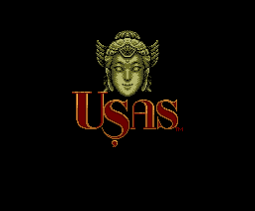
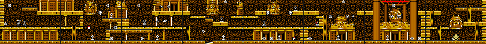
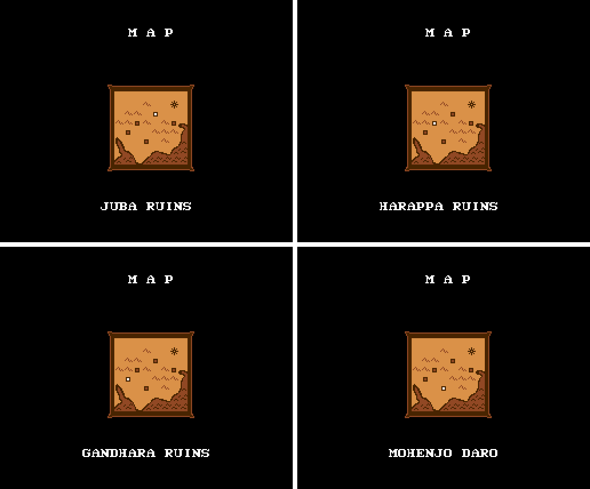
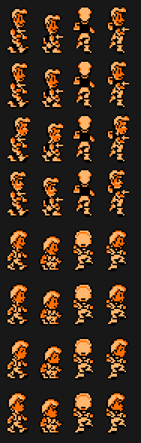
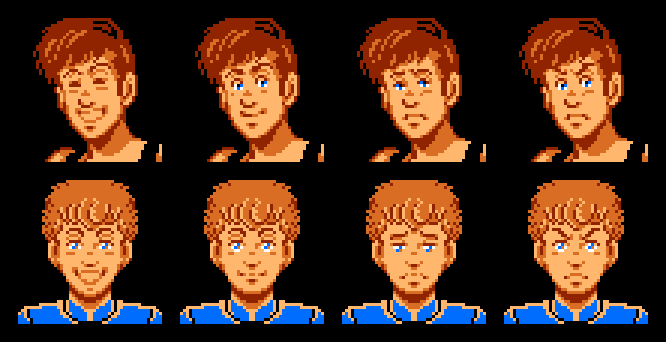
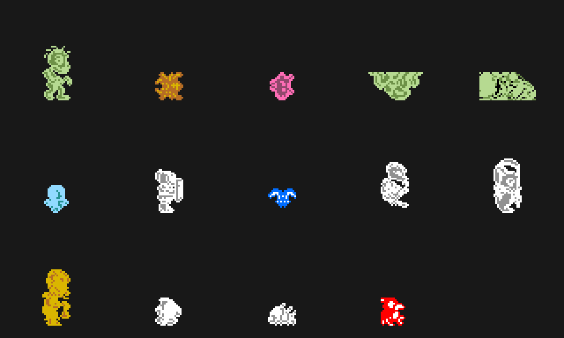
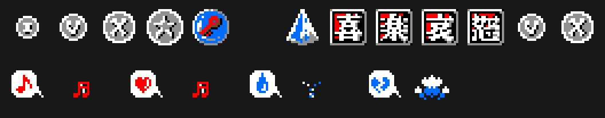
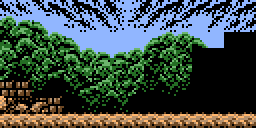

# Lo que el cartucho dibuja

Debajo de cada imagen está de dónde sale y qué se está viendo.

*La pantalla de t&iacute;tulo, montada desde la ROM: el mapa de 14 x 15 fichas de <code>p05:9988</code> (<code>p05:96EA</code>). Sin cotejar a&uacute;n contra la VRAM.*

*La primera fase de la primera ruina, pantalla a pantalla (mapa <code>p10:5FFE</code>), con lo que hay en cada una al entrar: enemigos y sus nidos (<code>p09:B12B</code>), trampas (<code>p15:A4F9</code>), objetos (<code>p12:B8BB</code>) y el jefe (<code>p09:BED3</code>).*

*El mapa de fuera (<code>p05:93C6</code>) con la ruina marcada y su clave, para las ruinas 1-4.*

*Wit y Cles andando, compuestos pieza a pieza (<code>p00:5BC6</code>) desde sus tablas de fotogramas (<code>p14:97AE</code>, <code>p14:9BCE</code>), al ritmo de <code>p01:69E6</code>.*

*Las caras de INFORMATION, una por estado de &aacute;nimo (<code>p06:A644</code>, <code>p06:A64C</code>).*

*Los enemigos de las listas de cada pantalla (<code>p09:B12B</code>), con sus fotogramas (<code>p15:B744</code>) y sus colores.*

*Los cuatro jefes de fase, los tipos 30 a 33.*

*Los objetos que se cogen (<code>p03:A81D</code>) y el globo que sale al cambiar de &aacute;nimo (<code>p15:A426</code>).*

*Una de las escenas del final, con las fichas que deja la anterior (<code>p04:71D5</code>).*
